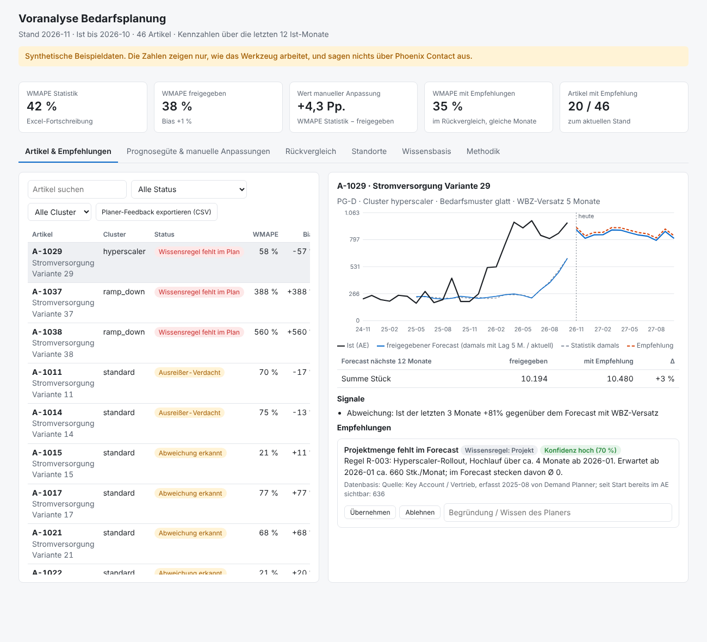

# PoC Voranalyse Bedarfsplanung – Phoenix Contact Power Supplies (BU Paderborn)

Prototyp zum Angebot **AG0021** („PoC zur KI-basierten Bedarfsplanung der BU Paderborn“). Er ist eine **ergänzende Entscheidungshilfe vor SAP IBP**. Er ersetzt weder IBP noch die Planer, und er ist kein Excel-Ersatz.

> Vor dem Lesen des Codes: [`docs/CHALLENGE.md`](docs/CHALLENGE.md) gleicht das gezeichnete Angebot mit dem Entwickler-Briefing ab und begründet den Zuschnitt. Kurz gesagt: Das Angebot ist verbindlich. Aus dem Briefing bleiben Fachlogik, WBZ-Versatz und Human-in-the-Loop. Generator mit Netting und Django-Plattform entfallen.

## Was der Prototyp tut

| Angebotsleistung | Umsetzung | Code |
|---|---|---|
| Analyse der historischen Bedarfs- und Prognosedaten | Einlesen von DTO, Forecast-Ständen, Artikelstamm und Matrix aus SAP-Dateien; Nachbau der Excel-Fortschreibung als Referenz | `io.py`, `baseline.py` |
| Prognosegüte und Wirkung manueller Anpassungen | WMAPE und Bias mit WBZ-Versatz; Forecast Value Added (Statistik vs. freigegeben) je Cluster; wie oft Erhöhungen/Senkungen geholfen haben | `accuracy.py` |
| Strukturierte Erfassung des Planungswissens | Wissensbasis `knowledge.yaml` (Regel, Quelle, Erfassungsdatum). Optional: Regel-Vorschläge aus Gesprächsnotizen per Sprachmodell | `knowledge.py` |
| Erkennung von Auffälligkeiten, Treibern, Risiken/Chancen | Ausreißer/Peaks (mit Länder- und Kundenkonzentration), Run-Rate/Trend gegen den Plan, systematischer Bias, Bedarfsmuster (glatt…sporadisch), Abweichungs-Ping | `analysis.py` |
| Empfehlungen mit Datenbasis und Konfidenz | Jede Empfehlung nennt Monate, Werte und Regel sowie eine Konfidenzstufe. Sie setzt auf dem freigegebenen Forecast auf | `analysis.py` |
| Rückvergleich mit eingetretenen Bedarfen | Zeitreise über vergangene Stichtage, nur mit damals bekanntem Wissen; Trefferquote je Empfehlungstyp | `analysis.backtest` |
| Abstimmung mit den Demand Plannern | HTML-Bericht mit „Übernehmen / Ablehnen + Begründung“, Export als CSV; Excel-Export mit Spalten für Entscheidung und Kommentar | `report.py` |

Ergebnis eines Laufs ist **eine HTML-Datei** (offline, ohne Server, Hell/Dunkel, im Phoenix-Contact-Layout, siehe [`docs/THEME.md`](docs/THEME.md)) plus **eine Excel-Datei**:



## Schnellstart

```bash
pip install -r requirements.txt
python -m pcpoc demo            # erzeugt synthetische Daten und rechnet out/voranalyse.html + .xlsx
python -m pytest -q             # Tests
```

Mit echten Daten (Format siehe [`docs/DATENVERTRAG.md`](docs/DATENVERTRAG.md)):

```bash
python -m pcpoc run pfad/zum/datenordner --out out
python -m pcpoc run pfad/zum/datenordner --stand 2026-09     # anderer Stichtag
```

Optional, Regel-Vorschläge aus Notizen der Planer-Termine (braucht `ANTHROPIC_API_KEY`; nur nach Freigabe durch Phoenix verwenden, es werden nur die Notizen übertragen):

```bash
python -m pcpoc wissen data/beispiel/planer_notizen.txt --out wissen_vorschlaege.yaml
```

## Deployment und Präsentation

- Render: `render.yaml` + `Dockerfile`, passwortgeschützt, Details in [`docs/DEPLOYMENT.md`](docs/DEPLOYMENT.md).
- Gliederung der Präsentationen für Challenge-Termin und Abschluss: [`docs/PRAESENTATION.md`](docs/PRAESENTATION.md).

## Aufbau

```
config/params.yaml      alle fachlichen Annahmen und Schwellen (Platzhalter bis zum Reverse-Engineering)
pcpoc/io.py             Eingangs-Adapter: SAP-Datei → kanonisches Format (später: IBP/REST)
pcpoc/baseline.py       Excel-Fortschreibung AE3/6/12 als Referenz
pcpoc/accuracy.py       Matching mit WBZ-Versatz, WMAPE, Bias, FVA
pcpoc/analysis.py       Signale, Empfehlungen, Rückvergleich, Standortverteilung
pcpoc/knowledge.py      Wissensbasis, optionale Extraktion aus Notizen
pcpoc/report.py         HTML-Bericht und Excel-Export
pcpoc/theme_phoenix.css Layout nach phoenixcontact.com (Farben, Signalkette); --theme neutral schaltet es ab
pcpoc/synth.py          synthetische Beispieldaten mit bekannten Mustern
docs/                   Abgleich Angebot/Briefing, PoC-Plan, Datenvertrag, offene Fragen
```

## Wichtige Grenzen

- **Die Beispieldaten sind synthetisch.** Die eingebauten Muster: Hyperscaler-Hochlauf, Abkündigung, Distributor-Peak, optimistische Planer, Projektwissen, das im Plan fehlt. Die Zahlen im Demo-Bericht zeigen nur, dass die Methode diese Muster findet. Über Phoenix Contact sagen sie nichts.
- Alle Parameter in `config/params.yaml` (AE-Gewichte, Schwellen, Dämpfung) sind Annahmen und müssen mit den Planern bestätigt werden.
- Die Konfidenz ist zunächst heuristisch. Erst der Rückvergleich auf echten Daten zeigt, welchen Regeltypen man trauen kann. Im Demo-Lauf ist z. B. die Bias-Regel kaum besser als der Planer, und genau solche Aussagen soll der PoC liefern.
- Nicht enthalten: Netting gegen Bestand, Euro-Werte, Szenarien, Freigabe-Workflow, Live-Anbindung an SAP.
- Kundendaten gehören nicht ins Repo (`.gitignore` schließt `data/*` außer `data/beispiel/` aus).
